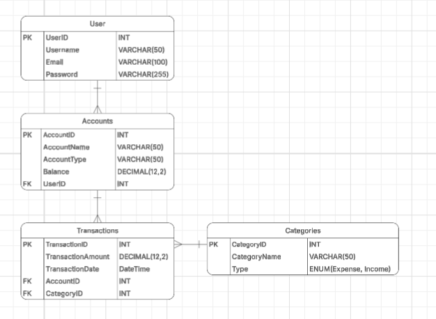

# Finance Tracker Project
5th semester Web Programming project


## Members : 
- Andrew Frederick Iskandar
- Jason Nicholas Rahardjo
- Bryan Vincent
- Nataniel Valen Andriko


## Pre-requisites : 
- PHP 8.2+ -> make sure to enable pg_mysql in php.ini
- Composer
- Mysql database
- Node.JS / npm


## Initialization Steps : 
- clone the repo ('git clone ... ')
- install composer for the project ('composer install')
- generate artisan key ('php artisan key:generate')
- create .env file by copy pasting .env.example file
- configure mysql database in .env (create the database in phpmyadmin)
- run a fresh migration for the database (php artisan migrate:fresh)
- install npm ('npm install')
- run vite ('npm run dev')
- open another terminal and run artisan serve ('php artisan serve')


## Features
- User Expense Tracker 
- User Income Tracker
- AI Finance Advisor using LLM API
- User Finance Summary Dashboard

## AI advisor setup

The dashboard advisor uses Groq's LLM API. Create an API key at https://console.groq.com/keys and replace the placeholder in your local `.env` file:

```
GROQ_API_KEY=your_groq_api_key_here
GROQ_MODEL=openai/gpt-oss-20b
```

## Initial ERD Design

